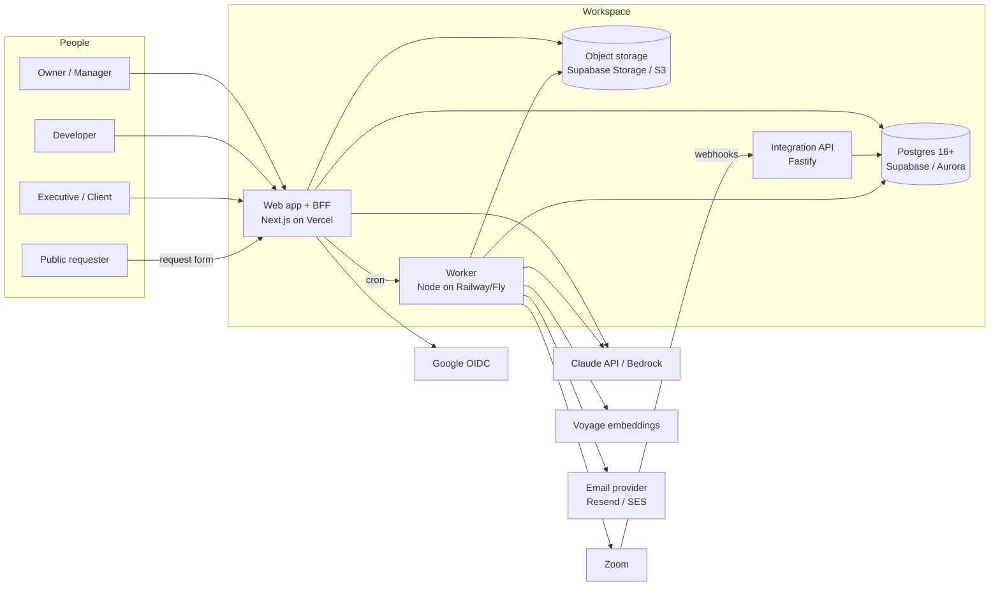
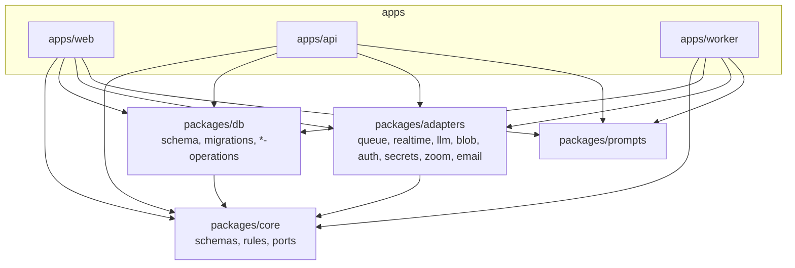

# 03 — System architecture

## 3.1 Goals and constraints

| Goal | Measure |
|---|---|
| Cheap to run while small | ≤ $60/month infrastructure for the first 50 paying orgs (chapter 08 §8.8) |
| Safe multi-tenancy | Every tenant row protected by Postgres RLS; no code path reads another org's data |
| Fast for people | p95 page data ≤ 300 ms, p95 mutation ≤ 400 ms, board drag ≤ 150 ms perceived (optimistic) |
| Works on serverless | Every user-facing feature runs on Vercel functions + Supabase. Background-only features degrade with a clear message |
| Portable | Same code on Architecture A (Vercel + Supabase + Anthropic) and B (AWS ap-south-1 + Bedrock) behind ports; moving between them is a migration project (§3.8), not a configuration change |
| One person can operate it | No Kubernetes, no self-managed Kafka/Elasticsearch/Redis until numbers demand it |

## 3.2 System context



## 3.3 Containers and responsibilities

| Container | Tech | Runs where (A / B) | Owns | Must not |
|---|---|---|---|---|
| **Web + BFF** (`apps/web`) | Next.js 15 App Router, React 19, Tailwind, route handlers | Vercel / ECS Fargate behind CloudFront | All browser-facing reads and writes; sessions; server rendering; AI helper calls that finish within 60 s | Run long jobs, hold Zoom tokens, poll |
| **Integration API** (`apps/api`) | Fastify 5, Zod, OpenAPI 3.1 | Railway/Fly (small) / ECS | Inbound webhooks (Zoom, email inbound, Stripe later), the **public developer API** (`/api/v1`, token auth), the MCP server, OpenAPI docs | Serve the web UI's own data needs |
| **Worker** (`apps/worker`) | Node 22, pg-boss; one image run as `worker-light` (2 replicas) and `worker-heavy` (chapter 11 §11.3) | Railway/Fly / ECS + SQS | Outbox relay, meeting pipeline, embeddings, rollups, automation runs, email sending, digests, webhooks out, imports/exports, retention purges | Accept HTTP from the internet (health only); run heavy and light queues in one process |
| **Database** | Postgres 16+, extensions `ltree`, `citext`, `pgcrypto`, `uuid-ossp`, `vector` | Supabase / Aurora Serverless v2 + RDS Proxy | All state, queues (pg-boss), rate-limit counters, idempotency keys | Be reached by the browser (Supabase Data API off) |
| **Object storage** | Supabase Storage / S3 + KMS | — | Files, raw transcripts, exports | Be public (all access via signed URLs) |
| **Cron** | Vercel Cron → `/api/cron/daily`; worker schedules | — | Digests, retention, rank rebalance, rollup sweeps | — |

## 3.4 Modular monolith and ports

The code is one deployable per container but **one domain**. Modules talk through functions in `packages/db`
(data) and `packages/core` (rules), not over the network.



**Ports** (in `packages/core/src/ports`): `QueuePort`, `RealtimePort`, `LLMPort`, `BlobStorePort`, `AuthPort`,
`SecretStorePort`, `ZoomPort` (to become one adapter of `MeetingProviderPort`, §3.10), and `EmailPort` (built in `752e2a4`: `send({to, subject, html, text, stream,
idempotencyKey?, headers?})`, streams `transactional | notifications`; adapters Resend and `console`). New ports
and extensions this guide adds:

| Port | Methods | Adapters (A / B) | Why a port |
|---|---|---|---|
| `EmailPort` (extend) | add `verifyWebhook(req)` for bounce/complaint events | Resend / Amazon SES | Feed `email_deliveries` and suppress bouncing addresses |
| `SearchPort` *(optional, later)* | `index(doc)`, `query(q, filter)` | Postgres FTS + pgvector (default) / OpenSearch Serverless | Only if Postgres search stops being enough (> ~5 M chunks) |
| `CalendarPort` | `listEvents(range)`, `watch(channel)` | Google Calendar / Microsoft Graph | Meeting → project mapping |
| `MeetingProviderPort` (generalises today's `ZoomPort`) | `listRecent(since)`, `getTranscript(meetingRef)`, `getParticipants(meetingRef)`, `verifyWebhook(req)`, `parseWebhook(req) → MeetingEvent`, `connect/refresh/disconnect` | Zoom (built), Google Meet, Microsoft Teams, Webex | One meeting pipeline (routing → extraction → approval) for every provider; §3.10 |
| `SpeechToTextPort` | `transcribe(audioKey, {language, diarize}) → Segment[]` | vendor chosen after the Indian English / Hinglish test (§3.10) | Fallback only: uploads and meetings without a platform transcript |
| `GitProviderPort` | `verifyWebhook`, `parseEvent`, `prUrl` | GitHub (Phase 1), GitLab, Bitbucket | Chapter 06 §6.11 |
| `WebhookSenderPort` | `deliver(endpoint, event)` | fetch with HMAC / same | Lets tests capture deliveries |

Rule unchanged: **`packages/core` imports no SDK.** ESLint and `architecture.test.ts` enforce it in CI.

### Module map (target)

| Module | Core (`packages/core/src/…`) | Data (`packages/db/src/…`) | Tables |
|---|---|---|---|
| Identity & org | `auth/`, `config/` | `auth-operations.ts` | orgs, users, memberships, invitations, user_preferences, api_tokens |
| Tree | `nodes/` | `node-operations.ts` | nodes, node_members, project_roles |
| Work | `tasks/`, `workflows/`*, `fields/`* | `task-operations.ts`, `workflow-operations.ts`* | tasks, workflows, workflow_statuses, workflow_transitions, work_types, field_definitions, task_links, task_watchers, labels, worklogs |
| Planning | `planning/`* | `planning-operations.ts`* | milestones (as tasks of type milestone), sprints, sprint_tasks, goals, goal_updates, goal_links |
| Knowledge | `docs/` | `doc-operations.ts` | docs (page tree), doc_versions, doc_templates |
| Collaboration | `comments/`, `notifications/`* | `comment-operations.ts`, `email-operations.ts` | comments, reactions, notifications, notification_preferences, email_deliveries |
| Files | `files/` | `file-operations.ts` | files |
| Requests | `requests/` | `request-operations.ts` | request_forms, requests |
| Insight | `health/`, `dashboards/`* | `rollup-operations.ts`, `dashboard-operations.ts`* | dashboards, dashboard_gadgets, saved_filters, progress_summaries |
| Automation | `automation/`* | `automation-operations.ts`* | automation_rules, automation_runs, automation_run_steps |
| Meetings | `zoom/` | `meeting-*`, `transcript-*`, `extraction-*`, `routing-*`, `resolution-*`, `approval-*` | meetings … action_item_decisions |
| AI | `ai/` | `ai-usage-operations.ts`* | ai_usage_ledger, chunks, task_embeddings |
| Platform | `errors/`, `pagination/`, `concurrency/` | `outbox-operations.ts`, `idempotency-operations.ts` | outbox, idempotency_keys, rate_limit_counters, activity_log, webhook_endpoints, webhook_deliveries, import_jobs, export_jobs |

`*` = new.

## 3.5 The one-backend decision (fixes D1)

Today the browser talks to Next.js route handlers, and Fastify duplicates org/member/task routes.
Decision:

| Traffic | Served by | Auth |
|---|---|---|
| Browser → app data | **Next.js route handlers** (`apps/web/src/app/api/orgs/[orgId]/…`) | httpOnly session cookie |
| Third-party integrations → public API | **Fastify** `/api/v1/…` | `Authorization: Bearer wsp_…` API token or OAuth |
| Providers → webhooks | **Fastify** `/webhooks/{zoom,email,stripe}` | Provider HMAC |
| AI agents → MCP | **Fastify** `/mcp` | API token (scoped) |

Both call the same `packages/db` operations, so behaviour cannot drift; only the transport differs.
Delete Fastify routes that only the web used (`routes/orgs.ts`, `routes/nodes.ts`, `routes/tasks.ts`, …) once
the public API is defined in chapter 06 §6.10, and re-add them there as token-authenticated versions.

## 3.6 Request lifecycle (web mutation)

```mermaid
sequenceDiagram
  participant B as Browser
  participant N as Next.js route handler
  participant C as packages/core
  participant D as packages/db
  participant PG as Postgres
  B->>N: PATCH /api/orgs/{org}/tasks/{id}<br/>If-Match: W/"v7", Idempotency-Key
  N->>N: verifyAndRefreshSession(cookie)
  N->>N: rateLimited(rules) (Postgres counter)
  N->>C: Zod parse body (UpdateTaskSchema)
  N->>D: resolveTenantForUser → {orgId, role}
  N->>D: updateTask(tenantSql, input, ifMatch)
  D->>PG: BEGIN; SET LOCAL ROLE workspace_app;<br/>set_config('app.org_id'), ('app.user_id')
  D->>PG: UPDATE tasks … WHERE id=$1 AND version=$2 RETURNING *
  D->>PG: INSERT activity_log, outbox(topic='task.updated')
  D->>PG: INSERT node_rollup_dirty ON CONFLICT bump
  D->>PG: COMMIT
  N-->>B: 200 {task}, ETag: W/"v8"
  Note over PG: worker relay picks outbox rows:<br/>notifications, automation, webhooks, realtime hint, embeddings
```

Rules:

1. **Everything a mutation causes later goes through the outbox in the same transaction.** Notifications,
   automation, webhooks, embeddings, realtime hints and email never run inline (except the AI helpers the user is
   waiting for). **Request code never calls `QueuePort.enqueue` directly**; only the outbox relay does. That
   keeps "job exists ⇔ data committed" true with pg-boss today and with SQS later, where an enqueue can't join
   a Postgres transaction (review #7). The code already follows this: the only direct enqueues are the relay
   itself (`apps/worker/src/relay.ts`) and a `system.ping` health route in `apps/api/src/routes/orgs.ts`.
2. **One transaction per request**, tenant context set with `SET LOCAL`. No connection state leaks between pooled
   requests (Supabase transaction pooler, port 6543).
3. **Precondition first.** `If-Match` mismatch → `412` before any write.
4. **Idempotent creates.** `POST` that creates accepts `Idempotency-Key`; a retry returns the stored response.

## 3.7 Background processing on the cheap stack

The open finding "background features need a worker that Vercel can't host" is solved in two layers:

| Layer | Runs on | Handles | Cost |
|---|---|---|---|
| **Inline-after-response** | Vercel function with `after()` (Next.js 15) | Small, best-effort work the user just triggered: mark rollup dirty and recompute one project; write notification rows | $0 extra |
| **Vercel Cron** | `/api/cron/daily`, `/api/cron/minute` (Pro plan allows per-minute) | Email digests, instant email batch (every minute), retention, rank rebalance, stale rollups | $0 extra on Pro |
| **Worker** | `worker-light` × 2 (512 MB) and `worker-heavy` × 1 (1 GB) on Railway / Fly.io / Render, `DATABASE_DIRECT_URL` (session mode) | pg-boss queues split by weight (chapter 11 §11.3) | ~$10–20/month |

Until the worker is deployed, the app must still work: automation shows *paused — background service not
running*, webhooks queue in `webhook_deliveries` and send when it starts, meeting import shows the existing note.

### Queue jobs (target `JobName` union)

| Job | Payload (Zod) | Producer | Consumer | Retries / backoff | Concurrency |
|---|---|---|---|---|---|
| `meeting.pipeline` | `{orgId, meetingId, generation}` | webhook intake, poller | worker | 5, exponential 30 s → 30 min | 2 |
| `meeting.routed` | `{orgId, meetingId, nodeId}` | routing | extraction | 3 | 2 |
| `notify` | `{orgId, notificationIds[]}` | outbox relay | email sender | 5, 1 min → 1 h | 5 |
| `index` | `{orgId, sourceType, sourceId, version}` | outbox | embedder | 5 | 4 |
| `rollup` | `{orgId, nodeId, generation}` | dirty sweep | rollup | 3 | 4 |
| `automation.run` *(new)* | `{orgId, ruleId, eventId, depth}` | outbox | automation engine | 3, then `failure` | 4 per org (fair) |
| `webhook.deliver` *(new)* | `{orgId, endpointId, deliveryId}` | outbox | sender | 8 over 24 h (1 m, 5 m, 30 m, 2 h, 6 h, 12 h, 24 h) | 8 |
| `import.run` *(new)* | `{orgId, importJobId}` | API | importer | 1 (resumable by cursor) | 1 per org |
| `export.run` / `export.erasure` | `{orgId, exportJobId}` | API | exporter | 3 | 1 per org |
| `org.maintenance` | `{orgId, kind}` | cron | worker | 3 | 1 |

## 3.8 Architecture A vs B

| Concern | A: Vercel + Supabase (now) | B: AWS ap-south-1 (later) | Switch |
|---|---|---|---|
| Web | Vercel | ECS Fargate ARM + CloudFront + WAF | deploy target |
| DB | Supabase Postgres (pooler 6543 txn / 5432 session) | Aurora Serverless v2 + RDS Proxy | `DATABASE_URL`, `DATABASE_DIRECT_URL` |
| Auth | Supabase Auth | Cognito (Google IdP + email OTP) | `AUTH_PROVIDER` |
| Files | Supabase Storage | S3 + KMS | `STORAGE_PROVIDER` |
| Queue | pg-boss | SQS + Step Functions | `QUEUE_PROVIDER` |
| Realtime | Supabase Realtime broadcast | AppSync Events | `REALTIME_PROVIDER` |
| LLM | Anthropic API | Bedrock (India inference profile) | `LLM_PROVIDER` |
| Email | Resend | SES | `EMAIL_PROVIDER` |
| When | 0 → ~300 orgs, or until a customer needs data in-country with AWS compliance papers | When contracts require it, or Supabase cost > ~$600/month | Stage 24 runbook |

**The ports make B possible, not a config change** (review #6). Env vars select adapters, but moving a live
product needs real migrations, each a small project:

| Port | What actually has to move | Rough effort |
|---|---|---|
| Auth | Users re-linked from Supabase Auth to Cognito by verified email (`users.cognito_sub`); every session ends once; Google OAuth client re-registered | 1–2 weeks incl. testing |
| Queue | In-flight pg-boss jobs drained before cut-over; outbox relay switched to SQS; Step Functions for the meeting pipeline | 1–2 weeks |
| Realtime | Clients switch from Supabase channels to AppSync Events; token minting changes | 1 week |
| Storage | Objects copied to S3 with the same keys; signed-URL code path switched | days |
| Database | `pg_dump`/restore or logical replication to Aurora; write freeze ≤ 30 min | 1 week incl. rehearsal |
| LLM | Bedrock model ids and India inference profile; prices differ | days |

Plan B as a 6–8 week project with a rehearsal, not a weekend switch.

**Recommendation:** stay on A. B costs a fixed ~$250–450/month before the first customer (NAT gateways, ALB,
Aurora minimum ACUs, interface endpoints), against ~$45/month for A (chapter 08 §8.8).

## 3.9 Cross-cutting concerns

| Concern | Design |
|---|---|
| Configuration | `packages/core/src/config` Zod-validates env at boot; production refuses to start with missing auth or session secret (built) |
| Logging | Structured JSON, PII/secret redaction (`logger/redactor.ts`), `x-request-id` per request, `org_id` and `user_id` hashed in logs |
| Errors | RFC 9457 problem+json everywhere (`problem.ts`, Fastify error handler) |
| Time | All timestamps `timestamptz` in UTC; dates that mean a calendar day (`due_date`, `start_date`) are `date`; "today" computed in the viewer's time zone |
| IDs | UUIDv7 (time-ordered, index-friendly); human keys `ENG-142` per project prefix |
| Money | `numeric(12,2)` INR for budgets, `numeric(12,6)` for per-call cost |
| Feature flags | `org_settings.features jsonb` + env kill switches; no third-party flag service |
| Postgres as many things | DB, queue, outbox, rate limits, search, vectors in one place on purpose; each moves out in a fixed order when a measured trigger fires (chapter 11 §11.4) |
| Timeouts | `statement_timeout`, `idle_in_transaction_session_timeout`, `lock_timeout` on the login roles (chapter 11 §11.5) |
| i18n | Strings in `apps/web/src/i18n/en.json` from the start of Phase 2; dates via `Intl` |

## 3.10 Meetings: providers, transcripts and what's out of scope

**`MeetingProviderPort`.** Zoom becomes one adapter of a provider-neutral port; the rest of the pipeline
(`transcript_segments`, routing, extraction, dedup, approvals) already doesn't care where a transcript came from.
`meetings.provider` already exists (`varchar(32) DEFAULT 'zoom'`); `integrations` is keyed by provider.

```ts
export interface MeetingEvent { kind: 'ended' | 'transcript_ready' | 'deauthorized'; providerMeetingId: string; accountId: string; at: IsoInstant }
export interface MeetingProviderPort {
  readonly provider: 'zoom' | 'google_meet' | 'teams' | 'webex';
  verifyWebhook(req: RawRequest): boolean;
  parseWebhook(req: RawRequest): MeetingEvent[];
  listRecent(conn: Connection, since: IsoInstant): Promise<MeetingSummary[]>;      // poller fallback
  getTranscript(conn: Connection, meetingRef: string): Promise<TranscriptSegment[] | null>; // null = no platform transcript
  getParticipants(conn: Connection, meetingRef: string): Promise<Participant[]>;
}
```

**Provider order and prerequisites** (verify each against the provider's current docs before building):

| Order | Provider | How | Customer prerequisites |
|---|---|---|---|
| 1 | **Zoom** (built; polish) | Account-level OAuth app, `recording.transcript_completed` webhook, 30-min poller fallback | Paid Zoom plan with cloud recording and audio transcripts turned on; account admin approves the app |
| 2 | **Google Meet** | Meet REST API conference records and transcripts; Google Workspace Events API subscription for "conference ended" / transcript available | A Google Workspace edition that includes Meet transcripts, transcripts turned on by the admin, Workspace admin approves the app's OAuth scopes |
| 3 | **Microsoft Teams** | Microsoft Graph online-meeting transcript APIs with change notifications | Microsoft 365 licences with Teams transcription enabled by tenant policy; tenant admin consent for the Graph permissions; the meeting must be transcribed |
| 4 | **Webex** | Webex meeting transcripts API | Only when a paying customer asks |

**Transcript source rule.** Use the platform's own transcript first: it is free to us, already has speaker names,
and avoids storing audio. Use a speech-to-text API only as a fallback: uploaded recordings, and plans or meetings
without a platform transcript. **Before choosing an STT vendor,** run a test on recordings in **Indian English
and Hinglish** (code-switched Hindi–English), scoring word error rate, speaker separation and names; the
vendor's English benchmark is not enough for our first customers.

**Consent.** Every connected provider shows meeting participants that the meeting is recorded and transcribed
(the platform's own banner where it exists, plus our notice in the meeting invite or first chat message where the
API allows), and we record consent per meeting before processing (`meetings.guest_consent_status`, built). See
chapter 09 §9.6.

**Decided not to build yet** — the full list with reasons is in chapter 12 §12.6: MCP as the meeting intake path,
a meeting bot API, our own video calling on LiveKit, and dictation tools.
