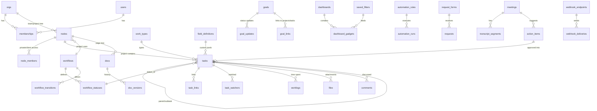

# 04 — Data model

Postgres is the system of record. This chapter lists every table that exists (migrations `0001`–`0021`), then
gives DDL for every table and column the parity features need, as migrations `0022`–`0036`.

## 4.1 Rules every table follows

| Rule | Why | How |
|---|---|---|
| `id uuid PRIMARY KEY DEFAULT uuid_generate_v7()` | Time-ordered IDs keep B-tree inserts at the right edge; no hot random pages | SQL function from `0001`; `generateUuidV7()` in core for app-side IDs (monotonic since PR #1) |
| `org_id uuid NOT NULL REFERENCES orgs(id) ON DELETE CASCADE` | Tenant key on every tenant row | RLS policy uses it; never updatable (`prevent_org_id_mutation()` trigger) |
| `UNIQUE (org_id, id)` and child FKs `(org_id, parent_id) → parent(org_id, id)` | A row can't reference another org's row even through a bug | compound FK pattern from `0001` |
| `created_at timestamptz NOT NULL DEFAULT now()`, `updated_at` on mutable tables | Audit and sync (`?updatedSince=`) | trigger `set_updated_at()` |
| `version integer NOT NULL DEFAULT 1` on user-edited rows | Optimistic concurrency (`If-Match`) | `UPDATE … WHERE version = $n` then `version = version + 1` |
| Soft delete via `archived_at` / `deleted_at` | Undo and Trash | Partial indexes `WHERE archived_at IS NULL` |
| Enumerations as `varchar(n)` + `CHECK (… IN (…))` | Easy to extend in a migration without `ALTER TYPE` locks | Mirror every list in a Zod enum in core |
| RLS `ENABLE` + `FORCE`; baseline policy + RESTRICTIVE gates | Defence in depth | Template in §4.18 |
| `jsonb` only for: documented shapes validated by Zod, sparse optional data, or caches | Avoid schemaless drift | Each jsonb column names its TypeScript type in a comment |

### Type choices

| Data | Postgres type | TypeScript | Notes |
|---|---|---|---|
| Identifier | `uuid` | `string` (branded `OrgId`, `TaskId`…) | UUIDv7 |
| Short label | `varchar(n)` | `string` | `n` set to the UI limit (title 512, name 255, key 32) |
| Email | `varchar(255)` (citext on `users.email` planned) | `string` | lower-cased before insert |
| Rich text | `text` (Markdown) + optional `jsonb` (editor AST) | `string` / `EditorDoc` | Markdown is canonical for search and AI |
| Calendar date | `date` | `string` `YYYY-MM-DD` | due/start dates; no time zone |
| Instant | `timestamptz` | `string` ISO 8601 | always UTC in DB |
| Duration | `integer` seconds | `number` | worklogs, estimates |
| Money | `numeric(12,2)` / `numeric(12,6)` | `string` (decimal) | never JS float for storage |
| Probability / score | `numeric(4,3)` | `number` | confidence, similarity |
| Ordering | `varchar(128) COLLATE "C"` | `string` | fractional rank (chapter 05 §5.4) |
| Tree path | `ltree` (stored as varchar today) | `string` | `nodes.path`, doc paths |
| Vector | `vector(1024)` | `number[]` | Voyage embeddings |
| Flags/enums | `varchar` + CHECK | string literal union | |

## 4.2 Entity-relationship overview (target)



## 4.3 Current tables (as built)

Column lists are abbreviated to type and meaning; the source of truth is `packages/db/src/schema/index.ts`
and the migrations.

### Identity and org

| Table | Key columns (type) | Notes |
|---|---|---|
| `orgs` | `id uuid`, `slug varchar(64) unique`, `name varchar(255)`, `plan varchar(32) default 'starter'`, `retention_days int 30–365 default 180`, `ai_budget_inr numeric(12,2) default 5000` | Tenant root, not RLS-protected by `org_id` (it *is* the org) |
| `users` | `id`, `email varchar(255) unique`, `name`, `cognito_sub`, `supabase_uid` | Global identity; one person, many orgs |
| `memberships` | PK `(org_id, user_id)`, `role varchar(32)` ∈ `owner, admin, member, viewer, client`, `session_epoch int` | Bumping `session_epoch` signs a person out everywhere |
| `invitations` | `email`, `role`, `token varchar(128) unique`, `invited_by`, `expires_at`, `accepted_at` | 7-day single-use links |

### Tree, work and docs

| Table | Key columns | Notes |
|---|---|---|
| `nodes` | `kind` ∈ `team, project`, `parent_id`, `name`, `path varchar(1024)` (ltree), `visibility` ∈ `public, private`, `rollup jsonb`, `key_prefix varchar(16)`, `version`, `archived_at` | One tree for teams and projects |
| `node_members` | PK `(node_id, user_id)`, `org_id` | Members of private projects and client grants |
| `tasks` | `project_id`, `parent_task_id` (1 level), `key varchar(32)` unique per org, `title varchar(512)`, `description text`, `status` ∈ `todo, in_progress, done, blocked`, `priority` ∈ `low, medium, high, urgent`, `assignee_id`, `start_date date` (0018), `due_date date`, `rank varchar(128)`, `version`, `source` ∈ `manual, zoom_meeting`, `source_ref`, `archived_at` | Index `(project_id, status, rank)` drives the board |
| `labels`, `task_labels` | org-wide labels, `color varchar(16)` | |
| `project_key_counters` | PK `(org_id, prefix)`, `last_number` | `UPDATE … RETURNING` for atomic keys |
| `docs` | `node_id`, `title varchar(500)`, `body_md text`, `body_json jsonb`, `version`, `source_meeting_id`, `archived_at` | Flat list per node |
| `doc_versions` | `(doc_id, version)` unique, last 30 kept | |
| `files` (0018) | `node_id`, `task_id` nullable, `name`, `content_type`, `size_bytes int`, `storage_key varchar(1024)`, `deleted_at` | Storage key is `org/{orgId}/files/{fileId}` |

### Collaboration, requests, AI

| Table | Key columns | Notes |
|---|---|---|
| `comments` | `target_type` ∈ `task, node, doc, meeting`, `target_id`, `parent_id`, `author_id`, `body_md`, `mentions jsonb uuid[]`, `deleted_at` | Visibility follows the target (0017 policy) |
| `notifications` | `user_id`, `kind varchar(32)`, `payload jsonb`, `read_at`, `dedupe_key`, `emailed_at` (0021) | Unique `(org_id, user_id, dedupe_key)` |
| `notification_preferences` (0021) | PK `(org_id, user_id)`, `email_mentions`, `email_requests`, `email_digest` bools | |
| `rate_limit_counters` (0021) | `key varchar(200)` (hashed), `window_start`, `count` | Shared across instances; purged by `sys_rate_limit_purge()` |
| `request_forms` (0019) | `node_id`, `public_token varchar(64)`, `intro text`, `enabled` | One per project |
| `requests` (0019) | `form_id`, `title varchar(200)`, `details`, `requester_name`, `requester_email`, `status` ∈ `new, accepted, declined`, `task_id` | Written only through `sys_request_submit()` |
| `progress_summaries` (0020) | `user_id`, `scope_key varchar(64)`, `body jsonb` | AI summary cache, 1 h reuse |
| `chunks` | `source_type` ∈ `task, meeting_notes, doc, transcript_segment`, `source_id`, `version`, `node_path`, `content text` | No embedding yet (D8) |
| `task_embeddings` | `task_id`, `content_hash`, `embedding_space`, `policy_version`, `embedding vector(1024)` | Dedup |
| `ai_usage_ledger` | `operation`, `provider`, `model`, `prompt_id`, `prompt_version`, `input_tokens`, `output_tokens`, `cost_inr numeric(12,6)`, `estimated`, `duration_ms`, `status` | Cost source of truth |

### Meetings (stages 11–17)

`integrations`, `zoom_oauth_states`, `zoom_host_consents`, `zoom_webhook_events`, `zoom_poll_checkpoints`,
`meetings` (status machine with 15 states, consent, routing, retention fields), `transcript_segments`
(`(meeting_id, seq)` anchors), `extraction_runs` (windows, tokens, cost), `meeting_notes`, `action_items`
(evidence, dedup, owner/due resolution, `state` ∈ `suggested, approved, edited, rejected`),
`action_item_decisions` (append-only eval log).

### Platform

`outbox` (topic, payload, attempts, lock, `sent_at`), `activity_log` (actor, verb, target, payload),
`idempotency_keys` (24 h), `node_rollup_dirty` (debounced rollups).

## 4.4 Identity additions — migration `0022_people_and_preferences.sql`

```sql
-- Per-person settings that today live in env vars or localStorage.
ALTER TABLE users
  ADD COLUMN IF NOT EXISTS time_zone      varchar(64),               -- IANA name, e.g. 'Asia/Kolkata'
  ADD COLUMN IF NOT EXISTS locale         varchar(16) DEFAULT 'en',  -- BCP 47
  ADD COLUMN IF NOT EXISTS avatar_key     varchar(1024),             -- storage key
  ADD COLUMN IF NOT EXISTS job_title      varchar(120),
  ADD COLUMN IF NOT EXISTS working_hours  jsonb;                     -- WorkingHours {days:[1..7], start:'09:00', end:'18:00'}

ALTER TABLE orgs
  ADD COLUMN IF NOT EXISTS time_zone   varchar(64) NOT NULL DEFAULT 'Asia/Kolkata',
  ADD COLUMN IF NOT EXISTS week_start  smallint    NOT NULL DEFAULT 1 CHECK (week_start BETWEEN 0 AND 6),
  ADD COLUMN IF NOT EXISTS logo_key    varchar(1024),
  ADD COLUMN IF NOT EXISTS accent      varchar(16);

ALTER TABLE memberships
  ADD COLUMN IF NOT EXISTS view varchar(10) NOT NULL DEFAULT 'pm'
    CHECK (view IN ('dev', 'pm', 'founder', 'client'));   -- role-based view, chapter 01 §1.5
-- Backfill: viewer → 'founder', client → 'client', everyone else → 'pm' (Developers who connect GitHub → 'dev').

CREATE TABLE IF NOT EXISTS user_preferences (
  org_id      uuid NOT NULL REFERENCES orgs(id) ON DELETE CASCADE,
  user_id     uuid NOT NULL REFERENCES users(id) ON DELETE CASCADE,
  sidebar     jsonb NOT NULL DEFAULT '{}',   -- SidebarPrefs {hidden: string[], order: string[]}
  home        varchar(32) NOT NULL DEFAULT 'for_you',  -- for_you | my_tasks | progress | project:<uuid>
  starred     jsonb NOT NULL DEFAULT '[]',   -- StarredItem[] {kind:'project'|'filter'|'dashboard'|'doc', id}
  recent      jsonb NOT NULL DEFAULT '[]',   -- RecentItem[] max 20, newest first
  shortcuts   boolean NOT NULL DEFAULT true,
  updated_at  timestamptz NOT NULL DEFAULT now(),
  PRIMARY KEY (org_id, user_id)
);

CREATE TABLE IF NOT EXISTS org_settings (
  org_id              uuid PRIMARY KEY REFERENCES orgs(id) ON DELETE CASCADE,
  default_view        varchar(10) NOT NULL DEFAULT 'pm' CHECK (default_view IN ('dev','pm')),
  announcement_md     text,
  announcement_until  timestamptz,
  public_sharing      boolean NOT NULL DEFAULT false,  -- allow public dashboard/progress links
  max_upload_mb       integer NOT NULL DEFAULT 25,
  features            jsonb   NOT NULL DEFAULT '{}',   -- OrgFeatures {automation?:bool, sprints?:bool, ...}
  welcome_md          text,
  updated_at          timestamptz NOT NULL DEFAULT now()
);

CREATE TABLE IF NOT EXISTS api_tokens (
  id            uuid PRIMARY KEY DEFAULT uuid_generate_v7(),
  org_id        uuid NOT NULL REFERENCES orgs(id) ON DELETE CASCADE,
  user_id       uuid NOT NULL REFERENCES users(id) ON DELETE CASCADE,
  name          varchar(100) NOT NULL,
  token_prefix  varchar(12)  NOT NULL,     -- 'wsp_ab12cd34', shown in UI
  token_hash    varchar(64)  NOT NULL,     -- SHA-256 of the full token; full token shown once
  scopes        jsonb NOT NULL DEFAULT '["read"]',  -- ApiScope[]: read | write | admin
  expires_at    timestamptz,
  last_used_at  timestamptz,
  revoked_at    timestamptz,
  created_at    timestamptz NOT NULL DEFAULT now(),
  UNIQUE (token_hash)
);
CREATE INDEX ON api_tokens (org_id, user_id) WHERE revoked_at IS NULL;
```

## 4.5 Workflows — migration `0023_workflows.sql` (fixes D5)

Design: each project uses one workflow; each status belongs to one of three **categories**. Everything that
counts progress (rollups, Progress view, PM view, dashboards) reads the category. The custom name is
presentation.

```sql
CREATE TABLE workflows (
  id          uuid PRIMARY KEY DEFAULT uuid_generate_v7(),
  org_id      uuid NOT NULL REFERENCES orgs(id) ON DELETE CASCADE,
  name        varchar(100) NOT NULL,
  description text,
  is_default  boolean NOT NULL DEFAULT false,
  template_key varchar(64),            -- 'simple' | 'approval' | 'content' | 'bug' | 'hiring' ...
  free_movement boolean NOT NULL DEFAULT true,  -- true = any status → any status (PM view default)
  version     integer NOT NULL DEFAULT 1,
  created_at  timestamptz NOT NULL DEFAULT now(),
  updated_at  timestamptz NOT NULL DEFAULT now(),
  UNIQUE (org_id, id)
);
CREATE UNIQUE INDEX uq_workflows_default ON workflows (org_id) WHERE is_default;

CREATE TABLE workflow_statuses (
  id          uuid PRIMARY KEY DEFAULT uuid_generate_v7(),
  org_id      uuid NOT NULL,
  workflow_id uuid NOT NULL,
  name        varchar(60) NOT NULL,
  category    varchar(16) NOT NULL CHECK (category IN ('todo','in_progress','done')),
  stage       varchar(16) NOT NULL CHECK (stage IN ('backlog','todo','in_progress','in_review','blocked','done','cancelled')),
                                                -- meaning, translated per view (chapter 01 §1.6); must agree with category
  CHECK ((stage IN ('backlog','todo') AND category = 'todo')
      OR (stage IN ('in_progress','in_review','blocked') AND category = 'in_progress')
      OR (stage IN ('done','cancelled') AND category = 'done')),
  color       varchar(16),
  position    smallint NOT NULL,                  -- board column order
  is_initial  boolean NOT NULL DEFAULT false,
  wip_limit   smallint CHECK (wip_limit IS NULL OR wip_limit > 0),
  legacy_key  varchar(32),                        -- 'todo','in_progress','done','blocked' for backfill
  archived_at timestamptz,
  UNIQUE (org_id, id),
  UNIQUE (workflow_id, name),
  FOREIGN KEY (org_id, workflow_id) REFERENCES workflows (org_id, id) ON DELETE CASCADE
);
CREATE UNIQUE INDEX uq_workflow_initial ON workflow_statuses (workflow_id) WHERE is_initial;

CREATE TABLE workflow_transitions (
  id            uuid PRIMARY KEY DEFAULT uuid_generate_v7(),
  org_id        uuid NOT NULL,
  workflow_id   uuid NOT NULL,
  name          varchar(60) NOT NULL,             -- button label: 'Send for review'
  from_status_id uuid,                            -- NULL = from any status
  to_status_id  uuid NOT NULL,
  rules         jsonb NOT NULL DEFAULT '{}',      -- TransitionRules (chapter 05 §5.3)
  position      smallint NOT NULL DEFAULT 0,
  FOREIGN KEY (org_id, workflow_id) REFERENCES workflows (org_id, id) ON DELETE CASCADE,
  FOREIGN KEY (org_id, to_status_id) REFERENCES workflow_statuses (org_id, id) ON DELETE CASCADE
);

ALTER TABLE nodes ADD COLUMN workflow_id uuid;  -- projects only; NULL = org default
ALTER TABLE nodes ADD CONSTRAINT fk_nodes_workflow
  FOREIGN KEY (org_id, workflow_id) REFERENCES workflows (org_id, id);

ALTER TABLE tasks
  ADD COLUMN status_id uuid,
  ADD COLUMN status_category varchar(16),        -- denormalised copy of workflow_statuses.category
  ADD COLUMN resolution varchar(32),             -- done | wont_do | duplicate | cannot_reproduce (Pro)
  ADD COLUMN completed_at timestamptz;
ALTER TABLE tasks ADD CONSTRAINT fk_tasks_status
  FOREIGN KEY (org_id, status_id) REFERENCES workflow_statuses (org_id, id);
```

**Backfill (same migration):**

1. For each org, create workflow *Simple* with statuses To do (category `todo`, stage `todo`, initial), Doing
   (`in_progress`/`in_progress`), Stuck (`in_progress`/`blocked`, `legacy_key='blocked'`), Done (`done`/`done`).
2. `UPDATE tasks SET status_id = s.id, status_category = s.category FROM workflow_statuses s
   WHERE s.org_id = tasks.org_id AND s.legacy_key = tasks.status`.
3. Keep `tasks.status` for one release as a generated mirror for old code paths, then drop the column and its
   CHECK in `0030`.
4. Replace index `idx_tasks_project_status_rank` with `(project_id, status_id, rank)` and add
   `(org_id, status_category, due_date)` for overdue queries.
5. A trigger `tasks_sync_status_category` keeps `status_category` and `completed_at` right on every status
   change, so rollups never join `workflow_statuses`.

The *Stuck* status keeps the meaning of today's `blocked` (stage `blocked`, shown as "Waiting on …" in the PM view, chapter 01 §1.6). In the Dev view, "blocked" is better
expressed as a `blocks` link (§4.8) and the board shows a red flag when an unfinished blocker exists.

## 4.6 Custom fields — migration `0024_fields.sql`

Decision: **JSONB on the task** + a definitions table. Alternatives considered:

| Option | Read cost | Filter cost | Schema change per field | Chosen |
|---|---|---|---|---|
| EAV table `task_field_values(task_id, field_id, value)` | 1 join per field; N+1 risks | indexable per type | none | No — joins explode on list views of 50 columns |
| One column per field (`ALTER TABLE`) | best | best | DDL per customer field — impossible multi-tenant | No |
| **`tasks.custom jsonb` keyed by field id** | zero joins | GIN `jsonb_path_ops` for equality/containment; expression index for hot numeric/date fields | none | **Yes** |

```sql
CREATE TABLE field_definitions (
  id           uuid PRIMARY KEY DEFAULT uuid_generate_v7(),
  org_id       uuid NOT NULL REFERENCES orgs(id) ON DELETE CASCADE,
  key          varchar(40) NOT NULL,         -- stable slug: 'budget', 'client', 'story_points'
  name         varchar(80) NOT NULL,
  type         varchar(16) NOT NULL CHECK (type IN
                 ('text','long_text','number','currency','date','select','multi_select','person','checkbox','url','rating')),
  options      jsonb NOT NULL DEFAULT '[]',  -- FieldOption[] {id, label, color} for select types
  config       jsonb NOT NULL DEFAULT '{}',  -- FieldConfig {currency?:'INR', min?, max?, decimals?}
  scope        varchar(8) NOT NULL DEFAULT 'org' CHECK (scope IN ('org','project')),
  project_id   uuid,                          -- when scope = 'project'
  builtin      boolean NOT NULL DEFAULT false,
  archived_at  timestamptz,
  position     smallint NOT NULL DEFAULT 0,
  created_at   timestamptz NOT NULL DEFAULT now(),
  UNIQUE (org_id, key),
  UNIQUE (org_id, id)
);

ALTER TABLE tasks ADD COLUMN custom jsonb NOT NULL DEFAULT '{}';  -- CustomValues: { [fieldId]: value }
CREATE INDEX idx_tasks_custom ON tasks USING gin (custom jsonb_path_ops);

-- Per-project field layout (replaces Atlassian's screens + screen schemes)
CREATE TABLE field_layouts (
  org_id      uuid NOT NULL,
  project_id  uuid NOT NULL,
  work_type_id uuid,                          -- NULL = all types
  fields      jsonb NOT NULL,                 -- FieldLayoutItem[] {fieldKey, required, section:'main'|'more'}
  updated_at  timestamptz NOT NULL DEFAULT now(),
  PRIMARY KEY (project_id, work_type_id)
);
```

Value encoding inside `custom` (validated by a Zod schema generated from the definition at write time):

| Field type | JSON value | Example |
|---|---|---|
| text / long_text / url | string | `"Acme Ltd"` |
| number / rating | number | `8` |
| currency | string decimal (avoid float) | `"125000.00"` |
| date | `"YYYY-MM-DD"` | `"2026-11-30"` |
| select | option id | `"opt_3f9"` |
| multi_select | option id[] | `["opt_1","opt_2"]` |
| person | user uuid | `"0192…"` |
| checkbox | boolean | `true` |

For a field that people sort or range-filter on (say `budget`), add an expression index on demand:
`CREATE INDEX ON tasks (org_id, ((custom->>'<fieldId>')::numeric)) WHERE custom ? '<fieldId>';`
— created by an admin action "Make this field fast to sort", capped at 5 per org.

## 4.7 Work types and hierarchy — migration `0025_work_types.sql`

```sql
CREATE TABLE work_types (
  id          uuid PRIMARY KEY DEFAULT uuid_generate_v7(),
  org_id      uuid NOT NULL REFERENCES orgs(id) ON DELETE CASCADE,
  name        varchar(40) NOT NULL,          -- Task, Milestone, Bug, Story, Request, Subtask
  icon        varchar(32) NOT NULL DEFAULT 'square-check',
  color       varchar(16),
  level       smallint NOT NULL CHECK (level IN (-1, 0, 1)),  -- 1 = epic/milestone, 0 = standard, -1 = subtask
  workflow_id uuid,                           -- NULL = project's workflow
  builtin     boolean NOT NULL DEFAULT false,
  archived_at timestamptz,
  UNIQUE (org_id, name), UNIQUE (org_id, id)
);
ALTER TABLE tasks ADD COLUMN work_type_id uuid;  -- backfilled: parent_task_id IS NULL → Task, else Subtask
```

Hierarchy rule (enforced by trigger `tasks_check_hierarchy`, replacing the one-level subtask trigger):
`parent.level = child.level + 1`. So milestone (1) → task (0) → subtask (−1). A task without a parent is fine at
any level. The PM view shows level 1 as **Milestone**; the Dev view shows the type name (Epic).

## 4.8 Links, watchers, reactions — migration `0026_links_watchers.sql`

```sql
CREATE TABLE task_links (
  id          uuid PRIMARY KEY DEFAULT uuid_generate_v7(),
  org_id      uuid NOT NULL,
  from_task_id uuid NOT NULL,
  to_task_id  uuid NOT NULL,
  link_type   varchar(16) NOT NULL CHECK (link_type IN ('blocks','relates','duplicates','clones')),
  created_by  uuid REFERENCES users(id) ON DELETE SET NULL,
  created_at  timestamptz NOT NULL DEFAULT now(),
  CHECK (from_task_id <> to_task_id),
  UNIQUE (from_task_id, to_task_id, link_type),
  FOREIGN KEY (org_id, from_task_id) REFERENCES tasks (org_id, id) ON DELETE CASCADE,
  FOREIGN KEY (org_id, to_task_id)   REFERENCES tasks (org_id, id) ON DELETE CASCADE
);
CREATE INDEX ON task_links (to_task_id);
-- 'A blocks B' is stored once; B shows it as 'is blocked by A'. 'relates' is stored with from<to to avoid duplicates.

CREATE TABLE task_watchers (
  org_id   uuid NOT NULL,
  task_id  uuid NOT NULL,
  user_id  uuid NOT NULL REFERENCES users(id) ON DELETE CASCADE,
  created_at timestamptz NOT NULL DEFAULT now(),
  PRIMARY KEY (task_id, user_id),
  FOREIGN KEY (org_id, task_id) REFERENCES tasks (org_id, id) ON DELETE CASCADE
);
CREATE INDEX ON task_watchers (user_id, org_id);

CREATE TABLE comment_reactions (
  org_id     uuid NOT NULL,
  comment_id uuid NOT NULL REFERENCES comments(id) ON DELETE CASCADE,
  user_id    uuid NOT NULL REFERENCES users(id) ON DELETE CASCADE,
  emoji      varchar(16) NOT NULL,   -- one of a fixed set: 👍 👎 🎉 ❤️ 👀 ✅
  PRIMARY KEY (comment_id, user_id, emoji)
);

ALTER TABLE tasks ADD COLUMN flagged boolean NOT NULL DEFAULT false;
```

## 4.9 Time tracking — migration `0027_time_tracking.sql`

```sql
ALTER TABLE tasks
  ADD COLUMN estimate_seconds  integer CHECK (estimate_seconds IS NULL OR estimate_seconds >= 0),
  ADD COLUMN spent_seconds     integer NOT NULL DEFAULT 0,        -- maintained by trigger from worklogs
  ADD COLUMN story_points      numeric(5,1);                      -- Dev view only

CREATE TABLE worklogs (
  id           uuid PRIMARY KEY DEFAULT uuid_generate_v7(),
  org_id       uuid NOT NULL,
  task_id      uuid NOT NULL,
  user_id      uuid NOT NULL REFERENCES users(id) ON DELETE CASCADE,
  started_at   timestamptz NOT NULL,
  seconds      integer NOT NULL CHECK (seconds > 0 AND seconds <= 86400),
  note         varchar(500),
  billable     boolean NOT NULL DEFAULT true,
  rate_inr     numeric(10,2),                    -- snapshot of the person's/project's rate at log time
  invoice_id   uuid,                             -- set when billed (invoicing later, P2)
  timer_running boolean NOT NULL DEFAULT false,  -- one running timer per person (partial unique index)
  created_at   timestamptz NOT NULL DEFAULT now(),
  FOREIGN KEY (org_id, task_id) REFERENCES tasks (org_id, id) ON DELETE CASCADE
);
CREATE INDEX ON worklogs (org_id, user_id, started_at DESC);
CREATE INDEX ON worklogs (task_id);
CREATE UNIQUE INDEX uq_worklogs_one_timer ON worklogs (user_id) WHERE timer_running;
```

Org settings for display: `org_settings.features.time = {hoursPerDay: 8, daysPerWeek: 5, unit: 'h'}` — the
same knobs as Atlassian's time-tracking screen (ref 350).

## 4.10 Sprints and saved filters — migration `0028_planning.sql`

```sql
CREATE TABLE sprints (                     -- Dev view only (org_settings.features.sprints)
  id          uuid PRIMARY KEY DEFAULT uuid_generate_v7(),
  org_id      uuid NOT NULL,
  project_id  uuid NOT NULL,
  name        varchar(80) NOT NULL,
  goal        varchar(500),
  state       varchar(12) NOT NULL DEFAULT 'future' CHECK (state IN ('future','active','closed')),
  starts_on   date, ends_on date,
  completed_at timestamptz,
  UNIQUE (org_id, id)
);
CREATE UNIQUE INDEX uq_one_active_sprint ON sprints (project_id) WHERE state = 'active';
ALTER TABLE tasks ADD COLUMN sprint_id uuid;   -- FK (org_id, sprint_id) → sprints

CREATE TABLE saved_filters (
  id          uuid PRIMARY KEY DEFAULT uuid_generate_v7(),
  org_id      uuid NOT NULL,
  owner_id    uuid NOT NULL REFERENCES users(id) ON DELETE CASCADE,
  name        varchar(100) NOT NULL,
  wql         text NOT NULL,                       -- source text (chapter 05 §5.6)
  ast         jsonb NOT NULL,                      -- parsed WqlNode, re-validated on read
  sharing     varchar(12) NOT NULL DEFAULT 'private' CHECK (sharing IN ('private','org','project')),
  project_id  uuid,
  columns     jsonb NOT NULL DEFAULT '[]',         -- ListColumn[] for list view
  created_at  timestamptz NOT NULL DEFAULT now(),
  updated_at  timestamptz NOT NULL DEFAULT now()
);
```

## 4.11 Dashboards — migration `0029_dashboards.sql`

```sql
CREATE TABLE dashboards (
  id          uuid PRIMARY KEY DEFAULT uuid_generate_v7(),
  org_id      uuid NOT NULL,
  owner_id    uuid REFERENCES users(id) ON DELETE SET NULL,
  name        varchar(100) NOT NULL,
  layout      varchar(8) NOT NULL DEFAULT 'two' CHECK (layout IN ('one','two','three')),
  sharing     varchar(12) NOT NULL DEFAULT 'private' CHECK (sharing IN ('private','org','public_link')),
  public_token varchar(64) UNIQUE,                 -- only when sharing = 'public_link' and org allows it
  is_org_default boolean NOT NULL DEFAULT false,
  version     integer NOT NULL DEFAULT 1,
  created_at  timestamptz NOT NULL DEFAULT now(),
  UNIQUE (org_id, id)
);
CREATE TABLE dashboard_gadgets (
  id           uuid PRIMARY KEY DEFAULT uuid_generate_v7(),
  org_id       uuid NOT NULL,
  dashboard_id uuid NOT NULL,
  kind         varchar(32) NOT NULL CHECK (kind IN (
                 'assigned_to_me','activity','projects_health','filter_results','pie',
                 'created_vs_done','two_dimensional','overdue','goals','workload','time_logged','text')),
  column_no    smallint NOT NULL,
  position     smallint NOT NULL,
  config       jsonb NOT NULL DEFAULT '{}',        -- GadgetConfig union per kind (chapter 05 §5.8)
  FOREIGN KEY (org_id, dashboard_id) REFERENCES dashboards (org_id, id) ON DELETE CASCADE
);
```

Gadgets compute through the same WQL engine with the **viewer's** permissions, so a shared dashboard never
shows a viewer something they can't open. A public-link dashboard runs as a synthetic `client`-like principal
limited to the dashboard owner's chosen projects.

## 4.12 Goals — migration `0031_goals.sql`

```sql
CREATE TABLE goals (
  id           uuid PRIMARY KEY DEFAULT uuid_generate_v7(),
  org_id       uuid NOT NULL,
  parent_goal_id uuid,
  kind         varchar(12) NOT NULL DEFAULT 'objective' CHECK (kind IN ('objective','key_result')),
  name         varchar(200) NOT NULL,
  why_md       text, measure_md text,
  owner_id     uuid REFERENCES users(id) ON DELETE SET NULL,
  target_period varchar(16),            -- '2026-Q4' | '2026-11' | NULL
  target_date  date,
  status       varchar(12) NOT NULL DEFAULT 'pending'
                 CHECK (status IN ('pending','on_track','at_risk','off_track','done','cancelled')),
  progress     numeric(5,2) CHECK (progress BETWEEN 0 AND 100),  -- manual or from links
  progress_source varchar(8) NOT NULL DEFAULT 'manual' CHECK (progress_source IN ('manual','links','metric')),
  metric       jsonb,                    -- GoalMetric {start, target, current, unit}
  access       varchar(12) NOT NULL DEFAULT 'open' CHECK (access IN ('open','restricted')),
  archived_at  timestamptz,
  version      integer NOT NULL DEFAULT 1,
  created_at   timestamptz NOT NULL DEFAULT now(),
  updated_at   timestamptz NOT NULL DEFAULT now(),
  UNIQUE (org_id, id)
);
CREATE TABLE goal_updates (            -- weekly status update (refs 384–387)
  id          uuid PRIMARY KEY DEFAULT uuid_generate_v7(),
  org_id      uuid NOT NULL, goal_id uuid NOT NULL,
  author_id   uuid REFERENCES users(id) ON DELETE SET NULL,
  status      varchar(12) NOT NULL,
  target_date date,
  body_md     varchar(5000) NOT NULL,
  ai_draft    boolean NOT NULL DEFAULT false,   -- drafted by AI, edited/posted by a person
  created_at  timestamptz NOT NULL DEFAULT now()
);
CREATE TABLE goal_links (
  org_id   uuid NOT NULL, goal_id uuid NOT NULL,
  target_type varchar(8) NOT NULL CHECK (target_type IN ('project','task','goal')),
  target_id uuid NOT NULL,
  PRIMARY KEY (goal_id, target_type, target_id)
);
CREATE TABLE goal_notes (              -- Learnings, Risks, Decisions tabs (refs 397–398)
  id uuid PRIMARY KEY DEFAULT uuid_generate_v7(),
  org_id uuid NOT NULL, goal_id uuid NOT NULL,
  kind varchar(10) NOT NULL CHECK (kind IN ('learning','risk','decision')),
  body_md varchar(5000) NOT NULL,
  author_id uuid REFERENCES users(id) ON DELETE SET NULL,
  created_at timestamptz NOT NULL DEFAULT now()
);
CREATE TABLE goal_followers (org_id uuid NOT NULL, goal_id uuid NOT NULL, user_id uuid NOT NULL,
  PRIMARY KEY (goal_id, user_id));
```

## 4.13 Docs as a page tree, and search — migration `0032_docs_tree_search.sql`

```sql
ALTER TABLE docs
  ADD COLUMN parent_doc_id uuid,
  ADD COLUMN path          varchar(1024),              -- ltree of doc ids under the node
  ADD COLUMN position      varchar(128) COLLATE "C" NOT NULL DEFAULT 'a0',
  ADD COLUMN emoji         varchar(16),
  ADD COLUMN status        varchar(12) NOT NULL DEFAULT 'published' CHECK (status IN ('draft','published')),
  ADD COLUMN template_key  varchar(64),
  ADD COLUMN restricted    boolean NOT NULL DEFAULT false;   -- only node members can see

ALTER TABLE chunks
  ADD COLUMN embedding vector(1024),
  ADD COLUMN tsv tsvector GENERATED ALWAYS AS (to_tsvector('simple', content)) STORED,
  ADD COLUMN node_id uuid,
  ADD COLUMN content_hash varchar(64);
CREATE INDEX idx_chunks_tsv ON chunks USING gin (tsv);
CREATE INDEX idx_chunks_embedding ON chunks USING hnsw (embedding vector_cosine_ops) WITH (m = 16, ef_construction = 64);
CREATE UNIQUE INDEX uq_chunks_source ON chunks (source_type, source_id, version, content_hash);

-- Cheap full-text search for the global search box without AI
ALTER TABLE tasks ADD COLUMN tsv tsvector GENERATED ALWAYS AS
  (setweight(to_tsvector('simple', coalesce(key,'') || ' ' || title), 'A') ||
   setweight(to_tsvector('simple', coalesce(description,'')), 'C')) STORED;
CREATE INDEX idx_tasks_tsv ON tasks USING gin (tsv);
ALTER TABLE docs ADD COLUMN tsv tsvector GENERATED ALWAYS AS
  (setweight(to_tsvector('simple', title), 'A') || setweight(to_tsvector('simple', body_md), 'C')) STORED;
CREATE INDEX idx_docs_tsv ON docs USING gin (tsv);
```

`'simple'` configuration is used because content mixes English, Hindi and names; stemming in one language
would hurt the others.

## 4.14 Automation — migration `0033_automation.sql`

```sql
CREATE TABLE automation_rules (
  id           uuid PRIMARY KEY DEFAULT uuid_generate_v7(),
  org_id       uuid NOT NULL,
  project_id   uuid,                         -- NULL = org-wide (Owner/Manager only)
  name         varchar(120) NOT NULL,
  enabled      boolean NOT NULL DEFAULT true,
  trigger      jsonb NOT NULL,               -- AutomationTrigger (chapter 07 §7.2)
  steps        jsonb NOT NULL,               -- AutomationStep[] (conditions, actions, branches)
  actor        varchar(12) NOT NULL DEFAULT 'automation' CHECK (actor IN ('automation','owner')),
  allow_rule_trigger boolean NOT NULL DEFAULT false,  -- may events caused by rules trigger this rule
  template_key varchar(64),
  owner_id     uuid REFERENCES users(id) ON DELETE SET NULL,
  version      integer NOT NULL DEFAULT 1,
  created_at   timestamptz NOT NULL DEFAULT now(),
  updated_at   timestamptz NOT NULL DEFAULT now(),
  UNIQUE (org_id, id)
);
CREATE INDEX ON automation_rules (org_id, enabled) WHERE enabled;

CREATE TABLE automation_runs (
  id          uuid PRIMARY KEY DEFAULT uuid_generate_v7(),
  org_id      uuid NOT NULL,
  rule_id     uuid NOT NULL,
  rule_version integer NOT NULL,
  event_id    uuid,                          -- outbox id that triggered it; NULL for scheduled/manual
  task_id     uuid,
  status      varchar(20) NOT NULL CHECK (status IN ('config_change','success','no_actions','in_progress',
                 'waiting','queued_for_retry','loop','throttled','some_errors','failure')),
  depth       smallint NOT NULL DEFAULT 0,   -- chain depth for loop detection
  steps_run   smallint NOT NULL DEFAULT 0,
  log         jsonb NOT NULL DEFAULT '[]',   -- RunLogEntry[] {stepId, outcome, message, ms}
  started_at  timestamptz NOT NULL DEFAULT now(),
  finished_at timestamptz,
  duration_ms integer
);
CREATE INDEX ON automation_runs (org_id, started_at DESC);
CREATE INDEX ON automation_runs (rule_id, started_at DESC);

CREATE TABLE automation_usage (           -- monthly metering for plan limits
  org_id uuid NOT NULL, month date NOT NULL,   -- first day of month
  runs integer NOT NULL DEFAULT 0, ai_actions integer NOT NULL DEFAULT 0,
  PRIMARY KEY (org_id, month)
);
```

## 4.15 Templates, imports, exports, webhooks, audit — migrations `0034`–`0036`

```sql
-- 0034 templates: shipped as JSON in packages/core/src/templates/*.json; only org-made ones are stored
CREATE TABLE project_templates (
  id uuid PRIMARY KEY DEFAULT uuid_generate_v7(),
  org_id uuid NOT NULL,
  name varchar(100) NOT NULL, category varchar(32) NOT NULL,
  body jsonb NOT NULL,          -- ProjectTemplate {workflow, fields, workTypes, tasks[], docs[], automations[]}
  created_by uuid, created_at timestamptz NOT NULL DEFAULT now()
);

-- 0035 import/export jobs
CREATE TABLE import_jobs (
  id uuid PRIMARY KEY DEFAULT uuid_generate_v7(),
  org_id uuid NOT NULL, created_by uuid,
  source varchar(16) NOT NULL CHECK (source IN ('csv','trello','asana','jira_csv','monday','clickup')),
  file_key varchar(1024) NOT NULL,
  mapping jsonb NOT NULL DEFAULT '{}',   -- ImportMapping {columns: {[col]: fieldKey}, projectId, statusMap}
  status varchar(12) NOT NULL DEFAULT 'queued' CHECK (status IN ('queued','running','done','failed','cancelled')),
  cursor integer NOT NULL DEFAULT 0, total integer, created_count integer NOT NULL DEFAULT 0,
  errors jsonb NOT NULL DEFAULT '[]', created_at timestamptz NOT NULL DEFAULT now(), finished_at timestamptz
);
CREATE TABLE export_jobs (
  id uuid PRIMARY KEY DEFAULT uuid_generate_v7(),
  org_id uuid NOT NULL, created_by uuid,
  kind varchar(12) NOT NULL CHECK (kind IN ('org_backup','user_data','project_csv','jira_csv','audit_csv')),
  status varchar(12) NOT NULL DEFAULT 'queued', file_key varchar(1024), expires_at timestamptz,
  created_at timestamptz NOT NULL DEFAULT now()
);

-- 0036 outbound webhooks and email log
CREATE TABLE webhook_endpoints (
  id uuid PRIMARY KEY DEFAULT uuid_generate_v7(),
  org_id uuid NOT NULL, name varchar(100) NOT NULL,
  url varchar(2048) NOT NULL CHECK (url LIKE 'https://%'),
  secret_ref varchar(255) NOT NULL,          -- secret store reference; HMAC key never in this table
  events jsonb NOT NULL,                     -- DomainEventName[]
  filter_wql text,                           -- optional: only tasks matching
  enabled boolean NOT NULL DEFAULT true,
  failure_count integer NOT NULL DEFAULT 0,  -- auto-disable at 50 consecutive failures
  created_at timestamptz NOT NULL DEFAULT now()
);
CREATE TABLE webhook_deliveries (
  id uuid PRIMARY KEY DEFAULT uuid_generate_v7(),
  org_id uuid NOT NULL, endpoint_id uuid NOT NULL REFERENCES webhook_endpoints(id) ON DELETE CASCADE,
  event_id uuid NOT NULL, event_name varchar(48) NOT NULL,
  attempt smallint NOT NULL DEFAULT 0, status varchar(12) NOT NULL DEFAULT 'pending'
    CHECK (status IN ('pending','delivered','failed','dead')),
  response_code smallint, response_ms integer, next_attempt_at timestamptz,
  created_at timestamptz NOT NULL DEFAULT now()
);
CREATE INDEX ON webhook_deliveries (next_attempt_at) WHERE status = 'pending';

CREATE TABLE email_deliveries (
  id uuid PRIMARY KEY DEFAULT uuid_generate_v7(),
  org_id uuid, user_id uuid, to_hash varchar(64) NOT NULL,     -- SHA-256 of address
  kind varchar(24) NOT NULL, provider_id varchar(128),
  status varchar(12) NOT NULL CHECK (status IN ('sent','delivered','bounced','complained','failed')),
  created_at timestamptz NOT NULL DEFAULT now()
);

-- activity_log gets the index the task Activity tab needs (D13)
CREATE INDEX idx_activity_target ON activity_log (org_id, target_type, target_id, created_at DESC);
-- outbox partial index (D12)
CREATE INDEX idx_outbox_pending ON outbox (created_at) WHERE sent_at IS NULL;
```

## 4.16 Project roles — part of `0022`

```sql
CREATE TABLE project_roles (               -- per-project override of org role (ref 55–60)
  org_id uuid NOT NULL, project_id uuid NOT NULL, user_id uuid NOT NULL REFERENCES users(id) ON DELETE CASCADE,
  role varchar(12) NOT NULL CHECK (role IN ('manager','contributor','viewer')),
  PRIMARY KEY (project_id, user_id)
);
```

Effective permission = `min(org role ceiling, project role)` for Developers; Owners/Managers are managers
everywhere; Executives/Clients stay read-only regardless (chapter 09 §9.3).

## 4.17 Index and storage budget

| Table | Rows at 300 orgs (assumption — measure after launch) | Avg row | Size incl. indexes | Hot indexes |
|---|---|---|---|---|
| tasks | 1.5 M | 1.2 KB | ~3.5 GB | `(project_id, status_id, rank)`, `(org_id, assignee_id, status_category, due_date)`, GIN `custom`, GIN `tsv` |
| comments | 3 M | 0.6 KB | ~2.5 GB | `(target_type, target_id, created_at)` |
| activity_log | 15 M | 0.4 KB | ~8 GB | `(org_id, target_type, target_id, created_at)` → **partition monthly** past 20 M rows |
| notifications | 10 M (90-day retention) | 0.3 KB | ~4 GB | `(user_id, read_at)` |
| chunks | 2 M | 5 KB (with 1024-dim vector = 4 KB) | ~12 GB | HNSW |
| transcript_segments | 6 M | 0.3 KB | ~2.5 GB | `(meeting_id, seq)` |

Total ≈ 35 GB at 300 orgs, which fits Supabase's Pro plan with a larger compute add-on (chapter 08 §8.8).
The single largest item is vectors: use **`halfvec(1024)`** (pgvector ≥ 0.7, 2 bytes per dimension) for
`chunks.embedding` to halve it with negligible recall loss, and embed only docs, meeting notes and task
descriptions longer than 200 characters.

**HNSW memory** (review #21): HNSW is fast only while the index sits in RAM. 5 M chunks × 1,024 dims as
`halfvec` is ~10 GB of vectors before graph overhead, more than a mid-size Postgres has spare. Limits: keep the
index under ~50 % of RAM; past that, (1) embed less (only content > 200 chars, no transcript segments — notes
already summarise them), (2) build **per-tenant partial indexes** for the few orgs with > 100 k chunks
(`CREATE INDEX … ON chunks USING hnsw (embedding halfvec_cosine_ops) WHERE org_id = '<big org>'`) and leave small
orgs on exact scans of their own rows, (3) only then move vectors to a dedicated store behind `SearchPort`.

**HNSW with tenant filter** (review #22): HNSW indexes don't filter by `org_id` well on their own; a global index
returns the nearest vectors across all orgs and RLS then throws most away, so recall for a small org drops. Query pattern:
`SET LOCAL hnsw.ef_search = 80; SELECT … FROM chunks WHERE org_id = $1 ORDER BY embedding <=> $2 LIMIT 40`
with `hnsw.iterative_scan = relaxed_order` (pgvector ≥ 0.8) so filtered queries keep scanning until enough
rows match; for orgs under 20 k chunks, an exact scan of the org's rows (B-tree on `org_id`, then distance sort)
is fast enough and gives perfect recall; big orgs use their partial index, where every candidate belongs to
them. The same applies to `task_embeddings` (migration `0022` adds a global HNSW index; revisit with partial
indexes when one org passes ~100 k tasks).

## 4.18 RLS template for every new table

```sql
ALTER TABLE <t> ENABLE ROW LEVEL SECURITY;
ALTER TABLE <t> FORCE ROW LEVEL SECURITY;

-- Baseline: same org
CREATE POLICY <t>_tenant ON <t> TO workspace_app
  USING (org_id = NULLIF(current_setting('app.org_id', true), '')::uuid)
  WITH CHECK (org_id = NULLIF(current_setting('app.org_id', true), '')::uuid);

-- Project-scoped rows: hide private projects the user isn't on, and non-granted projects for clients
CREATE POLICY <t>_project_visible ON <t> AS RESTRICTIVE TO workspace_app
  USING (acting_user_can_see_node(project_id));      -- one SQL function, STABLE, used by all project tables

-- Worker role sees one org at a time the same way
CREATE POLICY <t>_system ON <t> TO workspace_system
  USING (org_id = NULLIF(current_setting('app.org_id', true), '')::uuid);

GRANT SELECT, INSERT, UPDATE, DELETE ON <t> TO workspace_app, workspace_system;
```

Introduce `acting_user_can_see_node(uuid)` in `0022` to replace the repeated policy bodies in `0014`–`0019`; mark
it `STABLE` and `SECURITY DEFINER` with a fixed `search_path`, and cache the user's visible node ids per
statement via a `WITH` on `node_members`. Add a test per table in `runtime-rls.test.ts` (pattern already there).
