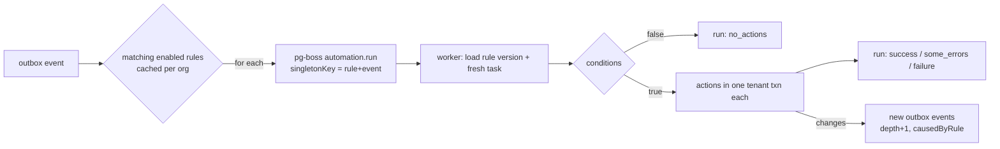

# 07 — Automation engine

Atlassian's automation (screenshots 69–197) is a rule builder with ~60 triggers, ~500 connector actions,
templates, an audit log and monthly usage limits. Non-technical teams use a small part of it heavily:
*when X happens, do Y*. This engine covers that part well and leaves the long tail to webhooks.

## 7.1 Rule anatomy

```
Rule = Trigger → [Condition | Action | Branch]*      (steps run in order; a failed condition stops the rule)
```

```ts
export interface AutomationRule {
  id: RuleId; name: string; enabled: boolean;
  projectId: ProjectId | null;          // null = org-wide
  trigger: AutomationTrigger;
  steps: AutomationStep[];              // max 25 steps, max branch depth 2
  actor: 'automation' | 'owner';        // whose name appears on changes
  allowRuleTrigger: boolean;            // may other rules' changes fire this rule
  version: number;
}
```

## 7.2 Triggers (v1: 15)

| Trigger | Config | Fires on event | Atlassian equivalent |
|---|---|---|---|
| `task.created` | `{typeIds?}` | `task.created` | Work item created |
| `task.transitioned` | `{fromStatusIds?, toStatusIds?, toCategory?}` | `task.transitioned` | Work item transitioned |
| `task.field_changed` | `{fields: string[]}` | `task.updated` with matching `changed` | Field value changed |
| `task.assigned` | `{}` | `task.assigned` | Work item assigned |
| `comment.created` | `{onlyExternal?: boolean}` (by E/C/requester) | `comment.created` | Work item commented |
| `task.due_soon` | `{daysBefore: 1..14}` | daily scheduler | Scheduled + JQL |
| `task.overdue` | `{}` | daily scheduler | Scheduled + JQL |
| `schedule` | `{cron: '0 9 * * MON', tz?, wql?}` (min hourly) | scheduler | Scheduled |
| `request.submitted` | `{formIds?}` | `request.submitted` | (JSM) Request created |
| `subtasks.all_done` | `{}` | derived on `task.transitioned` of a subtask | "When all sub-tasks are done" template |
| `link.created` | `{types?}` | `link.created` | Work item linked |
| `file.uploaded` | `{}` | `file.uploaded` | Attachment added |
| `meeting.notes_ready` | `{}` | `meeting.notes_ready` | (ours) |
| `goal.status_changed` | `{toStatus?}` | `goal.updated` | (Goals) |
| `manual` | `{label}` | button in task "⚡ Run" menu | Manual trigger from work item |

## 7.3 Conditions

| Condition | Config | Notes |
|---|---|---|
| `wql` | `{wql}` | Task matches a WQL query (compiled once per rule version, cached) |
| `field` | `{field, op, value}` | Simple-mode friendly version of WQL |
| `actor_is` | `{in: UserId[] | 'not_rule'}` | e.g. ignore changes made by rules |
| `related_tasks` | `{relation: 'subtasks'|'parent'|'blockers', all|any|none, wql}` | "all subtasks done" |
| `if_else` (branch) | `{if: Condition, then: Step[], else: Step[]}` | depth ≤ 2 |

## 7.4 Actions (v1: 20)

| Action | Config | Writes through | Cost class |
|---|---|---|---|
| `transition` | `{toStatusId}` | `planTransition` (rules still apply) | db |
| `assign` | `{to: UserId | 'reporter' | 'unassigned' | 'round_robin', poolIds?}` | `updateTask` | db |
| `set_field` | `{field, value | smartValue}` | `updateTask` | db |
| `add_label` / `remove_label` | `{labelId}` | | db |
| `comment` | `{bodyMd (smart values), internal?}` | `createComment` (author = rule actor) | db |
| `create_task` | `{projectId, title, …, parent: 'trigger'|null}` | `createTask` | db |
| `create_subtasks` | `{titles: string[]}` | | db |
| `clone_task` | `{projectId?}` | | db |
| `link_tasks` | `{type, to: 'trigger'|wql}` | | db |
| `set_due` | `{relative: '+3d'|'next_friday'|..., from: 'today'|'start'}` | | db |
| `notify` | `{to: 'assignee'|'watchers'|UserId[], message}` | notifications | db |
| `send_email` | `{to: 'requester'|'assignee'|emails[], subject, bodyMd}` | `EmailPort` | ~₹0.08/email (provider) |
| `send_slack` | `{webhookUrl ref, text}` | incoming-webhook URL in secret store | free |
| `send_teams` | `{webhookUrl ref, text}` | same | free |
| `web_request` | `{method, url, headers ref, body}` | `WebhookSenderPort`, same SSRF rules as §6.9 | free |
| `create_doc` | `{parentDocId, templateKey, title}` | `createDoc` | db |
| `ai_summarize` | `{target: 'task'|'thread', writeTo: 'comment'}` | LLM fast tier, **comment marked "AI draft"** | ~₹0.01–0.05 |
| `ai_classify` | `{field, options}` | LLM fast tier → proposal shown to the person; **auto-apply only if owner ticks it** | ~₹0.01 |
| `log` | `{message}` | run log only | free |
| `stop` | `{}` | ends rule | free |

The AI actions keep the "humans approve AI" principle: by default the AI's output is a suggestion (a comment
marked as AI, or a pending field change shown in the task drawer). The project manager may switch a rule to
apply automatically; that choice is logged in `config_change`.

## 7.5 Smart values

Mustache-style, evaluated in a sandbox (no code execution, no property access beyond a whitelist):

| Token | Value |
|---|---|
| `{{task.key}}`, `{{task.title}}`, `{{task.url}}` | task fields |
| `{{task.assignee.name}}`, `{{task.due}}`, `{{task.status}}`, `{{task.cf.budget}}` | |
| `{{trigger.actor.name}}`, `{{trigger.from}}`, `{{trigger.to}}` | event data |
| `{{request.requesterName}}`, `{{request.title}}` | request trigger |
| `{{now}}`, `{{today}}`, `{{today.plusDays(3)}}` | dates in org time zone |
| `{{project.name}}`, `{{project.url}}` | |

Implementation: a tiny parser (~150 lines) that resolves dotted paths against a frozen context object and a fixed
set of helpers (`plusDays`, `format('d MMM')`, `upper`, `lower`, `truncate(n)`). Unknown tokens render empty and
log a warning in the run.

## 7.6 Execution model



1. **Matching** — the relay loads the org's enabled rules and filters by trigger type and cheap config
   (status ids, fields). Only matches enqueue. The cache is per worker replica, so it must be invalidated on
   every replica at once (review #32): saving a rule runs `NOTIFY automation_rules, '<orgId>'` in the same
   transaction, and each replica `LISTEN`s on its session-mode connection and drops that org's entry. A 5-minute
   TTL is the backstop if a notification is missed (e.g. during a reconnect). A rule saved while an event is
   already being matched applies from the next event.
2. **Idempotency** — job `singletonKey = ruleId:eventId`; a redelivered event never runs a rule twice.
3. **Freshness** — the worker reloads the task; if it no longer exists or the rule version changed, the run ends
   as `no_actions` with a reason.
4. **Each action is its own transaction** under `workspace_system` with `app.org_id` set, so one failing action
   (e.g. a transition refused by a validator) doesn't roll back earlier ones. Result `some_errors`.
5. **Actor** — changes are recorded with `actor_id = NULL` and `payload.rule = {id, name}`; the UI shows
   "Automation (rule name)".
6. **Waiting** — `web_request` and `send_email` run async; the run shows `waiting` until the delivery resolves.

## 7.7 Loop detection and limits

| Guard | Value | Result |
|---|---|---|
| Chain depth (`depth` carried in event payload) | > 5 | `loop`, rule auto-disabled after 3 loops in 1 h, Owner notified |
| `allowRuleTrigger = false` (default) | events caused by any rule are ignored by this rule | — |
| Same rule on same task | > 10 runs / 10 min | `throttled` |
| Per rule | 100 runs / min | `throttled` |
| Per org | plan monthly runs (TBD — pricing not decided) | `throttled`, banner in UI, Owner email at 80 % |
| Scheduled rule result set | ≤ 500 tasks per firing | rest skipped, logged |
| Action time | 10 s per action, 60 s per run | `failure` |
| Retries | system errors only: 3 tries, 30 s → 5 min | `queued_for_retry` then `failure` |

Counted against usage: one **run** = one rule execution that passed its conditions (runs that end in
`no_actions` don't count — same rule as Atlassian's "automation steps" metering is unnecessary complexity).

## 7.8 Audit log

`automation_runs` keeps 90 days (longer retention on higher plans: TBD — pricing not decided). The audit page (like refs 84–188) filters by rule, status,
date range, trigger type and task key, and shows the status legend from ref 188 verbatim:

| Status | Meaning shown to people |
|---|---|
| Config change | The rule was changed by someone |
| Success | The rule ran and did everything |
| No actions performed | The rule ran but its conditions stopped it |
| In progress | Running now |
| Waiting | Waiting for an email or web request to finish |
| Queued for retry | Something failed; it will try again soon |
| Loop | Rules kept triggering each other; stopped |
| Throttled | Over the limit for this rule or this month |
| Some errors | Some steps failed (see details) |
| Failure | Nothing could be done (see details) |

## 7.9 Recipe gallery (PM view)

Ship 20 recipes as JSON templates in `packages/core/src/automation/recipes/`. Each is one card with blanks to
fill:

1. When a task is **done**, close its subtasks.
2. When **all subtasks are done**, move the parent to **Done**.
3. When a task is **created** with no owner, **assign** it round-robin to *[people]*.
4. **Every Monday 9:00**, post a comment on overdue tasks reminding the owner.
5. When a task is **due tomorrow**, notify the owner.
6. When a **request** arrives, create a task and email the requester "We got it".
7. When a request task is **done**, email the requester "It's done".
8. When a task moves to **In review**, assign it to *[reviewer]*.
9. When a task is **flagged**, notify the project manager.
10. When a **client comments**, notify the task owner and the project manager.
11. When a task's **due date passes**, add label *late*.
12. When a task is **created from a meeting**, add label *meeting*.
13. When a task in *[project]* is **done**, post to Slack.
14. When a **file** is uploaded to a task, notify watchers.
15. When a task **moves to Doing**, set start date to today.
16. When a task **moves to Done**, set resolution *Done* and log time in a comment.
17. **Every Friday 16:00**, AI-summarise the week's done tasks into a comment on the project Discussion.
18. When a task is **created**, AI suggests labels (shown for approval).
19. When a goal turns **at risk**, notify its followers.
20. When **meeting notes** are ready, notify the host to review suggestions.

"Describe it in words" (P2): a strong-tier call turns a sentence into a draft `AutomationRule` JSON validated by
Zod, shown in the builder for a person to review and save. Never saved automatically.
